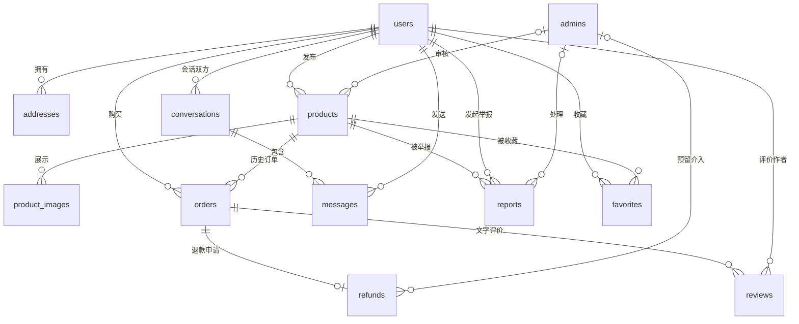

# 数据库设计与课程报告对应

## 来源与变化

采用 MySQL 8.0.16+ / 8.4、InnoDB、utf8mb4。交接确认最终报告十二表；未收到原始最终报告，因此以下是基于模型落实的可执行设计，需要交作业前与原报告核对字段长度、可空性及命名。

没有恢复旧十三表中的 `conversation_products`，没有独立成色、评分或管理员姓名。登录增加用户/管理员密码哈希字段。订单增加数据库生成列用于唯一约束，不是新增业务实体。

## 实体关系

会话表包含两列用户外键；为避免 A-B 与 B-A 重复，较小用户编号存 initiator_id、较大编号存 peer_id。**这两列在本版表示规范化的会话双方，不保留“谁先发起”的语义**；该点应与报告命名核对。

## 关键约束

- 所有实体编号为 INT 主键，favorites 使用 `(user_id, product_id)` 复合主键；金额为整数分。
- 用户手机号唯一、管理员登录名唯一；密码保存在 `password_hash`，采用独立随机盐和 PBKDF2WithHmacSHA256（210000 次迭代），不进入业务 DTO。
- 外键保护用户、商品、订单、会话及历史记录。业务删除服务先检查历史，再清理图片、收藏，最后删商品。
- 每订单最多一条退款；每个订单每位参与者最多一条文字评价；会话双方组合唯一。
- 订单 `active_product_id`：待付款/待交付/待收货/已完成时等于商品编号，否则为 NULL。唯一索引阻止同一商品出现多个有效订单；MySQL 允许多个 NULL。
- CHECK 验证商品价格为正、交付方式至少一种，以及主要商品/订单状态。跨表的“禁止自买”“消息发送者属于会话”“评价作者为买卖双方”等由 Service 校验。
- 自提订单的收件信息可为空；快递地址由 Java 验证后复制到订单。后续修改个人地址不改订单快照。
- 时间保持交接的北京时间文本格式 `yyyy-MM-dd HH:mm:ss`，不是 Java Date 或 SQL TIMESTAMP；不要在答辩时声称已使用时间类型。
- 图片为本地资源路径或经过格式、大小检查的图片 Data URL，保存在 `MEDIUMTEXT`。没有伪装成磁盘文件上传系统。

## JDBC 与事务实际如何工作

`MarketRepository` 不再持有可作为数据源的内存 state。snapshot 在数据库事务中 SELECT 十二张表；写操作使用以下流程：

1. 在同一 MySQL 连接的事务中，对管理员首行 `SELECT ... FOR UPDATE` 获取全局业务写锁。
2. 读取当前十二表，生成本次业务工作副本。
3. Service 验证规则并修改副本。
4. Repository 比较前后主键和字段，仅对新增、修改、删除行执行参数化 INSERT/UPDATE/DELETE。
5. 成功提交；异常由 `TransactionTemplate` 回滚。行锁在事务结束时释放。

这样复用了现有 Service 规则，又让数据真正落到关系表。它是面向课程小数据集的折中：每次读取十二表、所有写事务串行，不适用于大量用户的高并发系统。并非每张表一个 Repository，也不是 JPA/MyBatis。

Repository 的反射只用于**固定白名单的十二个 Java 模型字段**，SQL 值用占位符绑定，客户端不能传入表名、列名或 SQL。元数据缓存禁用后读取 MySQL 自增高水位，保证商品删除后重新创建不复用已提交编号；回滚允许有编号间隙。

## 建库与初始化

`database/create-database.sql` 创建库和应用账号；`schema.sql` 为十二表建表语句，应用启动也会执行同一份资源文件。种子数据仅在 admins 为空的首次初始化时按环境变量选择插入。不要把这个判断当作正式数据库迁移工具：已有非本版结构需要单独迁移，不能靠 CREATE TABLE IF NOT EXISTS 改列。

数据库手动查询示例见 `database/verification.sql`。正式备份用 MySQL Workbench 的 Data Export 或 `mysqldump`；源代码压缩包不包含运行中的个人业务数据。
