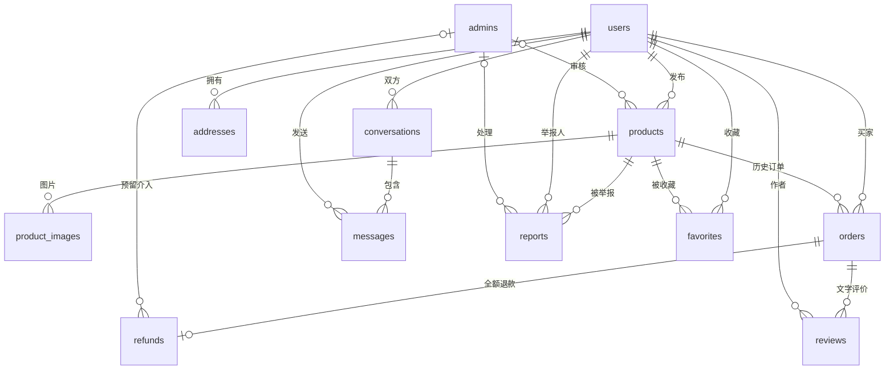

# MySQL 十二表与 MyBatis 实现

设计来源及与旧 SQLite SQL、Chen 图的差异见 `报告与SQL差异核对.md`。字段和约束以 `database/schema.sql` 为准，它与应用资源 `src/main/resources/db/schema.sql` 完全一致。

## Mapper 层

十二个业务 Mapper 分别对应十二表，每个接口有同名 XML。额外 SchemaMapper 只查询 information_schema/初始化计数，不代表第十三张表。

- namespace = 接口全限定名；XML id = 接口方法名。
- resultMap 显式指定 SQL 列与 Java public 字段，保持 snake_case，不依赖隐式驼峰规则。
- `#{}` 绑定值；无客户端拼接表名/列名，也不使用 `${}` 插入查询参数。
- insert 配置 useGeneratedKeys/keyProperty；MySQL 生成编号并回填到实体，不再读取元数据或 MAX+1。
- ProductMapper.search 使用 where/choose/if 处理 scope、分类、关键词。关键词用 LOCATE 做字面包含查询，`%` 和 `_` 不被当作通配符。
- 未使用 JPA、MyBatis-Plus 或分页插件；MyBatis 通过标准 MySQL JDBC 驱动执行 SQL。

## 事务与并发

CatalogService、TradeService、CommunityService 写操作采用 Spring `@Transactional`，业务事务隔离级别 READ_COMMITTED。锁后读到的是最新已提交记录，避免等待锁后仍读旧快照。

下单锁 products 当前行，验证可售、检查有效订单、插入订单、更新商品锁定状态。事务提交前其他同商品买家等待；唯一生成列索引提供额外保护。不同商品不再竞争“管理员首行全局锁”。

已有订单操作先锁订单，再锁商品；退款申请也锁该订单，因此退款与发货/收货检查互斥。处理退款在获得锁后重新锁读退款状态，防止重复处理。

会话创建按编号从小到大锁双方用户，双方反向发起不会重复；生成列唯一索引保证无序组合唯一。新会话保留实际 initiator_id，不再将发起者替换成较小编号。

发布商品与图片、删除商品与图片/收藏、处理举报与商品下架等在同一业务事务内。任何未捕获运行时异常都会回滚已执行的 SQL。

## 保留的页面查询方式

`MarketRepository.snapshot()` 通过类型明确的 Mapper 查询十二表，用于 /api/market 的组合响应和测试。AccountService 在一致性只读事务内过滤隐私。这个查询方式适合课程小数据量，仍非分页的大规模方案。

MarketRepository 不再保存持久化 state，不再反射拼 SQL，不再包含 transaction/Operation/allocateProductId。业务写入不依赖 snapshot，不存在全量差异写回。

## 数据库运行

首次空库可由应用自动建表并插入种子，也可手动执行 schema.sql + insert-demo.sql。已有 v3 库先备份并运行 migrate-v3-to-v4.sql。不能直接把 SQLite 十三表 SQL 执行到 MySQL，也不能认为 CREATE TABLE IF NOT EXISTS 会自动改旧表。

密码字段在实体上 @JsonIgnore；MyBatis 直接映射该字段供登录验证，页面 DTO 与 JSON 不输出密码哈希。示例数据使用独立随机盐，运行期间不会重新初始化已有账号。
